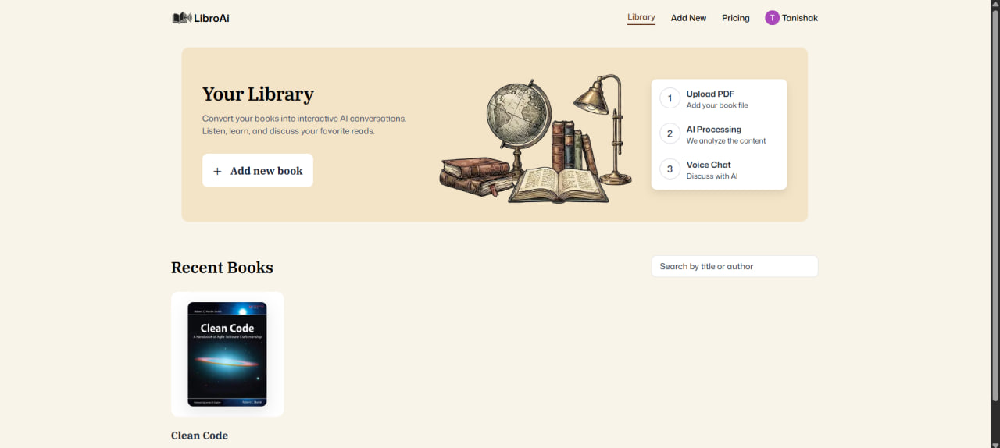
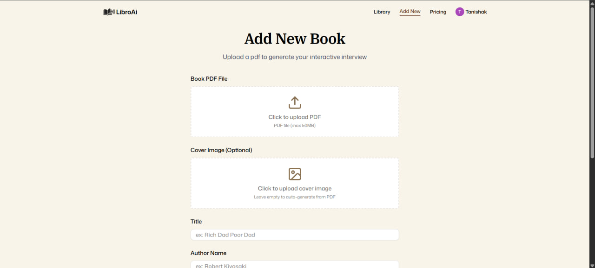
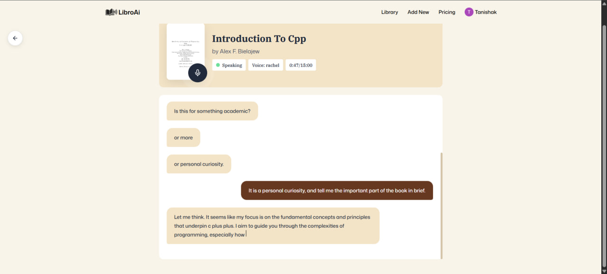
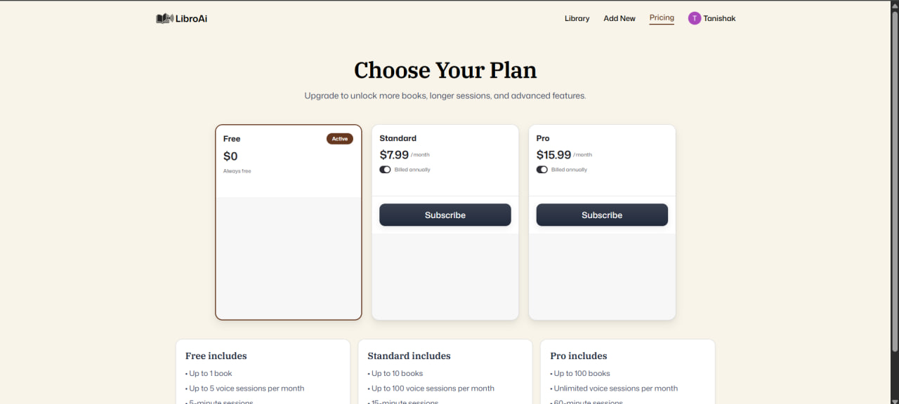

<p align="center">
  
</p>

# 📚 Lumora — AI-Powered Book Companion

Lumora is a full-stack AI application that transforms static books into **interactive conversational experiences**. Users can upload PDFs and interact with them through a voice-enabled assistant that understands and responds based on the book’s content.

---

## 🚀 Features

- 📄 **PDF Upload & Parsing**
  - Upload books in PDF format
  - Extract and process content into structured segments

- 🧠 **AI-Powered Conversations**
  - Ask questions and interact with book content
  - Context-aware responses based on parsed data

- 🎙️ **Voice Assistant Integration**
  - Real-time voice interaction using Vapi
  - Dynamic conversational flow

- 🔐 **Authentication & User Management**
  - Secure login/signup with Clerk
  - Personalized user sessions

- 📊 **Usage & Session Handling**
  - Track user sessions
  - Enforce usage limits (sessions, duration, etc.)

- ☁️ **Cloud Storage**
  - File uploads managed via Vercel Blob
  - Efficient storage and retrieval

- ⚡ **Modern UI/UX**
  - Built with Next.js App Router
  - Clean, responsive interface

---

## 🛠️ Tech Stack

- **Frontend:** Next.js (App Router), React, Tailwind CSS  
- **Backend:** Next.js Server Actions  
- **Database:** MongoDB (Mongoose)  
- **Authentication:** Clerk  
- **Storage:** Vercel Blob  
- **Voice AI:** Vapi  
- **Deployment:** Vercel  

---

## 📂 Project Structure

```bash
Ai-book-companion-project/
│
├── app/
│   ├── api/
│   │   └── upload/
│   │       └── route.ts              # Vercel Blob upload handler
│   │
│   ├── books/
│   │   ├── [slug]/
│   │   │   └── page.tsx              # Book interaction page
│   │   └── new/
│   │       └── page.tsx              # Upload new book page
│   │
│   ├── subscriptions/
│   │   └── page.tsx                  # Pricing page
│   │
│   ├── layout.tsx                    # Root layout (ClerkProvider, Navbar)
│   ├── page.tsx                      # Home page
│   └── globals.css                   # Global styles
│
├── components/
│   ├── ui/
│   │   ├── Navbar.tsx
│   │   ├── Button.tsx
│   │   ├── Input.tsx
│   │   ├── Form.tsx
│   │   └── sonner.tsx                # Toast notifications
│   │
│   ├── FileUploader.tsx
│   ├── VoiceSelector.tsx
│   ├── LoadingOverlay.tsx
│   └── UploadForm.tsx
│
├── hooks/
│   ├── useVapi.ts                    # Voice session logic
│   └── useLatestRef.ts
│
├── lib/
│   ├── actions/
│   │   ├── book.actions.ts
│   │   └── session.actions.ts
│   │
│   ├── database/
│   │   └── mongoose.ts
│   │
│   ├── utils.ts
│   ├── constants.ts
│   └── zod.ts
│
├── models/
│   ├── Book.ts
│   └── BookSegment.ts
│
├── types/
│   └── index.ts
│
├── public/
│   ├── assets/
│   └── screenshots/
│
├── .env.local
├── next.config.ts
├── tailwind.config.ts
├── tsconfig.json
├── package.json
└── README.md
```

## 🧪 How It Works

1. User uploads a PDF

2. The file is parsed into segments

3. Data is stored in MongoDB

4. User starts a voice session

5. AI responds based on book content

## 📸 Screenshots

### Home Page
<p align="center">
  
</p>

### Upload Book
<p align="center">
  
</p>

### Book Interaction
<p align="center">
  
</p>

### Subscriptions
<p align="center">
  
</p>

## 🔐 Key Concepts Implemented

1. Server-side validation & error handling

2. Slug-based routing for books

3. Data serialization for MongoDB

4. Custom hooks for voice session handling

5. Efficient state management with React hooks

## 🚀 Getting Started (Local Setup)

### 1️ Clone the repository
```bash
git clone https://github.com/your-username/ATSight.git
cd ATSight
```
### 2️ Install dependencies
```bash
npm install

```

### 3 make api keys and add in .env
```bash
#clerk
NEXT_PUBLIC_CLERK_PUBLISHABLE_KEY
CLERK_SECRET_KEY

#mongodb
MONGODB_URI

#vercel
VERCEL_BLOB_READ_WRITE_TOKEN

#vapi
NEXT_PUBLIC_ASSISTANT_ID
NEXT_PUBLIC_VAPI_API_KEY


```

### 4 Run the project
```bash
npm start
```

The app will run on:

http://localhost:3000

### 🧪 Build for Production
```bash
npm run build
```

### Known bugs of book project :-

- Development mode supported in every log in 

- Pricing highlighting is not showing of existing plan on pricing page

## 🤝 Contributing

Contributions are welcome! Feel free to fork the repo and submit a pull request.


